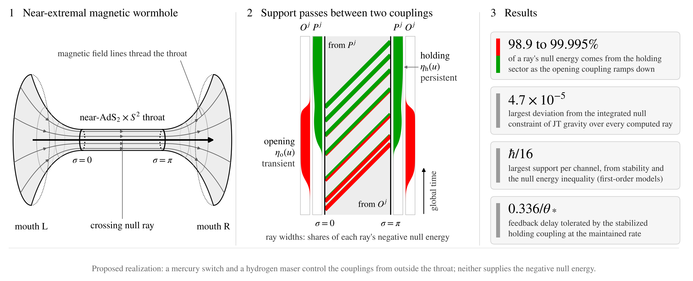

# Transfer of gravitational support between distinct quantum couplings in near-extremal traversable wormholes



Code and data behind every number and figure in the manuscript titled "Transfer of gravitational support between distinct quantum couplings in near-extremal traversable wormholes".

A near-extremal magnetically charged black-hole pair is described in Jackiw-Teitelboim gravity. A transient opening coupling and a persistent holding coupling act on distinct sets of boundary channels. The code solves the boundary equations, computes the exact first-order null stress of each sector along crossing rays, checks it against the integrated null constraint, and bounds the support of one channel through stability and the null quantum energy inequality.

## Main results

- A ray launched as the opening coupling ramps down draws 98.9 to 99.995% of its negative null energy from the holding sector.
- The two sectors satisfy the integrated null constraint along every computed ray to 4.7 × 10⁻⁵.
- The stabilized holding coupling (dimension 2) tolerates feedback delays up to 0.336/θ*.
- In the first-order models, stability and the null quantum energy inequality limit the support of one channel to ħ/16. The null-line two-point function of every channel equals the massless one (to 3.3 × 10⁻⁹ for 1/4 ≤ Δ ≤ 6), so the conformal bound applies at any channel dimension.

## Contents

| Path | Purpose |
| --- | --- |
| `scripts/transfer_model.py` | The model and its 70 checks (sections S1 to S5); writes `results_transfer.json` |
| `scripts/fig1_schematic.py` | Fig. 1: geometry and the two couplings, with computed ray shares |
| `scripts/fig2_transition.py` | Fig. 2: evolution through the transition |
| `scripts/fig3_support.py` | Fig. 3: ray-integrated null energy by sector |
| `scripts/fig4_requirements.py` | Fig. 4: capture region and channel requirements |
| `scripts/eqcheck.py` | Symbolic and numerical checks of the manuscript equations |
| `scripts/figstyle.py` | Shared figure style (STIX fonts, final printed size) |
| `scripts/results_transfer.json` | Stored output of `transfer_model.py` |
| `scripts/capture_map.npy` | Cached capture map for Fig. 4(a); delete it to recompute |


## Reproduce

Python 3.10 or later (tested with 3.13, NumPy 2.5, SciPy 1.18, Matplotlib 3.11, mpmath 1.3, SymPy 1.14).

```bash
pip install -r requirements.txt
cd scripts
python transfer_model.py        # 70 checks, then writes results_transfer.json (about two minutes)
python fig1_schematic.py        # manuscript figures go to figures/, which git ignores
python fig2_transition.py
python fig3_support.py
python fig4_requirements.py     # uses capture_map.npy if present
python eqcheck.py               # equation checks
python graphical_abstract.py    # assets/graphical_abstract.png
```

Every run of `transfer_model.py` ends with `70 checks, 0 failures` when the environment is correct. The figure scripts read `results_transfer.json`, so run the model first after any change to it.

## Scope

The calculation keeps the leading order of the near-horizon dynamics, first order in the couplings and leading order in the inverse channel number; traversal is the probe limit of an infinitesimal signal. The per-channel limit holds for the generalized free channels and boundary conditions of the model. The mercury switch and hydrogen maser are a proposed realization: they control the couplings from outside the throat and supply none of the negative null energy, and their coupling strengths are not derived here.

## Citation

See `CITATION.cff`. Please cite the manuscript once its reference is available.

## License

MIT, see `LICENSE`.
